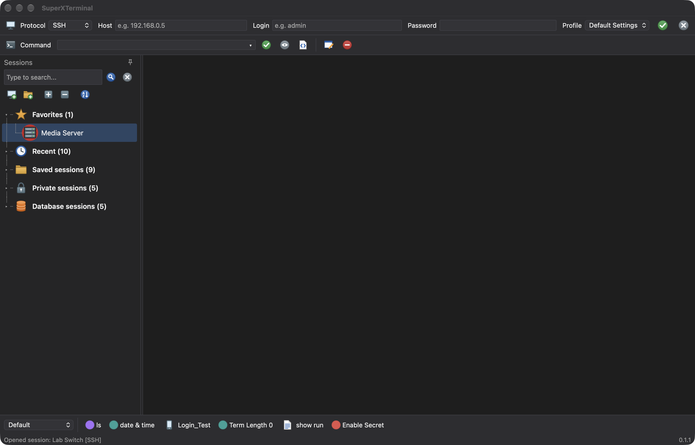
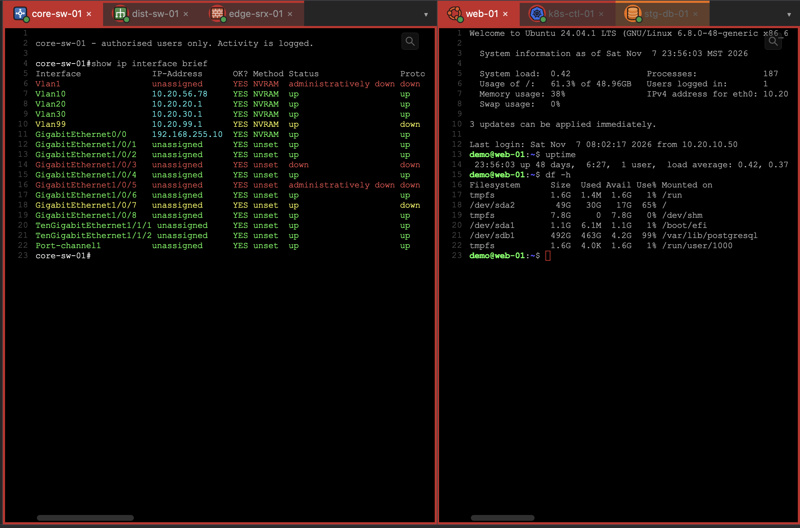
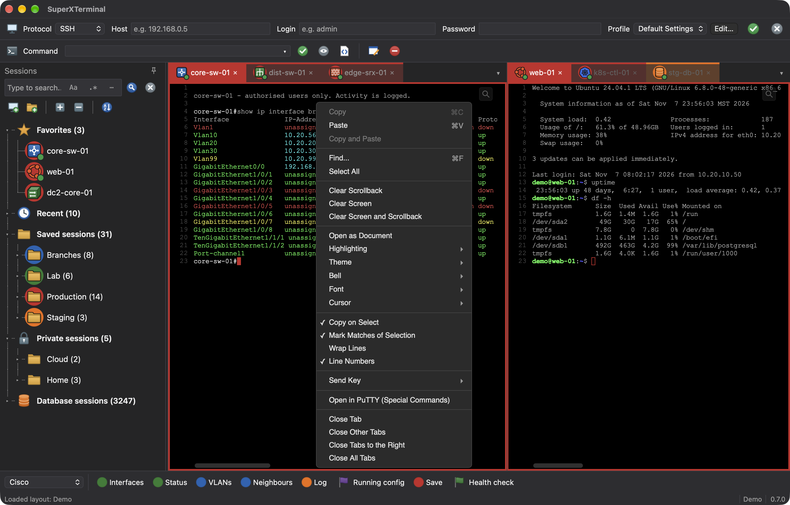
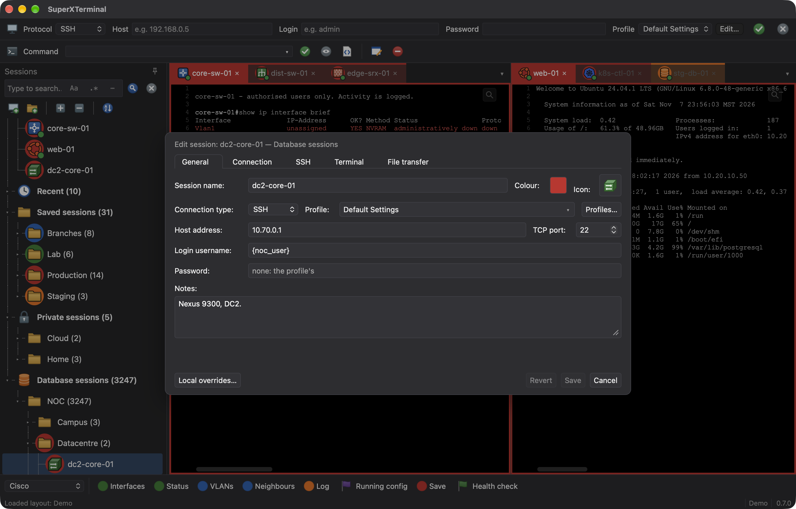
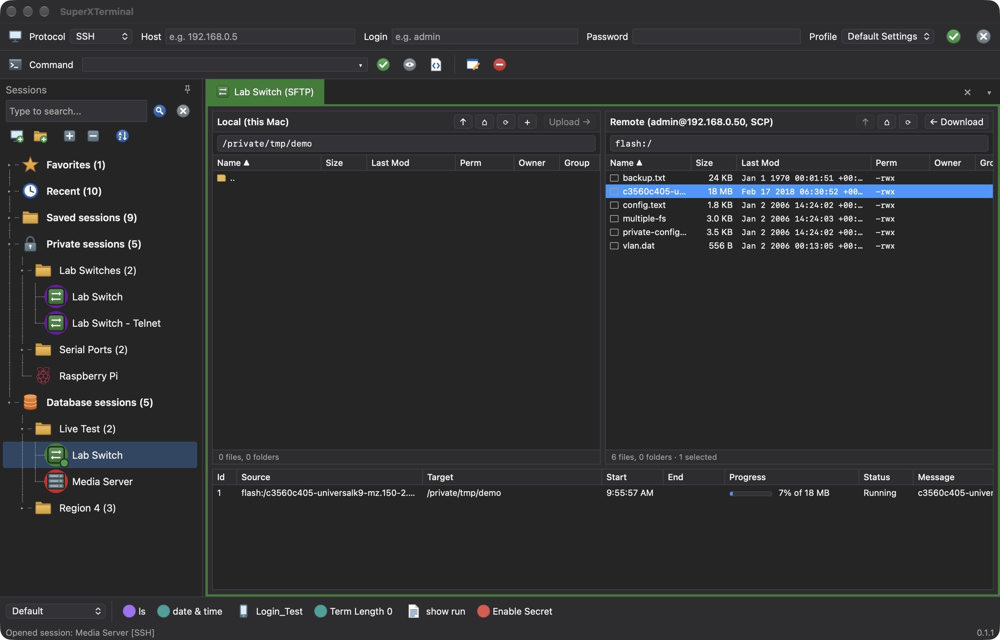
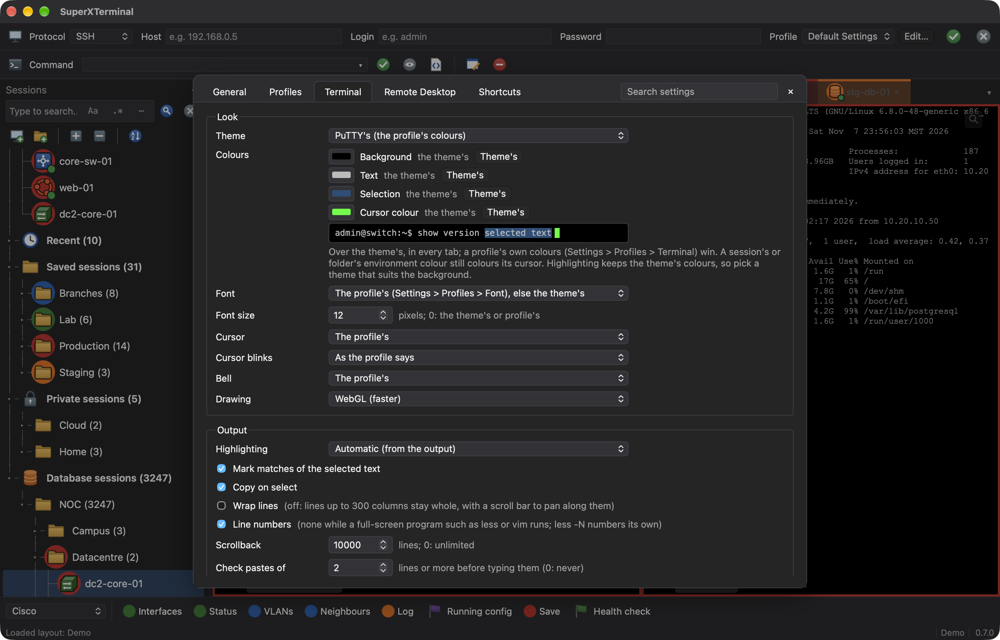

# SuperXTerminal

A consistent Mac and Windows alternative to SuperPuTTY: a terminal and session manager for people who look after a lot
of servers and network devices. A tree of saved sessions, tabs and splits, SSH, Telnet, serial and Remote Desktop in
the same window, a button bar of commands, and highlighting for Cisco and Junos output, built to look and work the same
on both systems.



## Where it comes from

SuperXTerminal is inspired by [SuperPuTTY](https://github.com/jimradford/superputty) by Jim Radford, the Windows
application that put PuTTY sessions into tabs with a sessions tree beside them, and by
[SilverGreen93's fork](https://github.com/SilverGreen93/superputty), which carried it on.

SuperPuTTY puts PuTTY's own windows inside its tabs, which only Windows can do. SuperXTerminal draws every tab itself
instead: SSH goes through the system's own OpenSSH in a terminal drawn by [xterm.js](https://xtermjs.org), so it looks
and works the same on the Mac and on Windows. It's built with [Tauri 2](https://tauri.app) and Svelte 5.

## Screenshots

| | |
|---|---|
|  |  |
| **Splits and highlighting.** Sessions side by side, each framed in its environment colour, with Cisco output coloured live (interfaces up in green, down in red). The buttons send to the split you're typing in. | **The terminal's menu.** Copy and paste, Find, clearing, Open as Document, highlighting, theme, font and cursor, Wrap Lines, and Send Key. |
|  |  |
| **Edit Session.** Connection, profile, highlighting, jump host, script and file transfer paths. A Database session is shared with the team, so it warns against passwords and takes `{key}` placeholders that each user fills in. | **File transfer.** This computer's files beside the session's: here a switch's flash over SCP, with an IOS image downloading. |
|  | |
| **Settings.** The terminal's theme, font, cursor, highlighting, wrapping, scrollback and paste check, for every tab. | |

## Features

**Sessions**

- A sessions tree with folders, Saved and Private sessions, Favorites and Recent, search as you type, drag to move,
  multi-select, and bulk editing.
- Sessions in SuperPuTTY's `Sessions.xml` format, with folders, button bars, highlighting rules and scripts beside it.
  Keep them in a shared folder and a team on Mac and Windows works from one set; changes made elsewhere show up within
  seconds.
- Database sessions: a PostgreSQL table shared by the team, with an offline cache, locked rows and fields, and changes
  written when the connection comes back.
- Icons (62 templates and 26 brand logos, or your own), and environment colours (production in red, say) on the tree,
  the tab, the terminal's frame and the cursor.
- Profiles for usernames, passwords (kept in the system's keychain), key files (PuTTY `.ppk` keys too), SSH algorithms
  and older algorithms for older devices.
- Jump hosts, PuTTY-style extra arguments, `{key}` placeholders from Environment Variables, and local overrides.
- Import from SuperPuTTY XML, PuTTY and KiTTY, MobaXterm, `.rdp` files and `~/.ssh/config`; CSV export and import.

**Connections**

- SSH, Telnet, Raw, Serial (`/dev/cu.*` on the Mac, COM ports on Windows), local shells, and Remote Desktop in a tab.
- Serial line settings that change without reconnecting, Break, and Telnet's Special Commands.
- VNC through Screen Sharing, FileZilla for files, and Connect external to open a session in Terminal.app (or
  Windows App for RDP).
- Dropped sessions reconnect by themselves.

**Terminal**

- Tabs, splits (side by side or stacked), more windows, and layouts that reopen a set of sessions.
- Highlighting rules for Cisco, Junos and generic output, chosen per tab, session or folder.
- Wrap Lines on or off. With it off, long lines stay whole, a scroll bar pans along them, and the view follows the
  cursor as you type.
- Find, Search Output, Highlighted Output (the tab's output in Monaco), and Compare Output between two tabs.
- Session logs with time stamps, paste checking for multi-line pastes, and watching a tab for activity or silence.

**Commands and scripts**

- A button bar and a Send Commands bar that send to the tab you're in, or to every tab you choose.
- SPSL, SuperPuTTY's scripting language (SENDLINE, WAITFOR, SENDKEY, SENDBREAK and more), with a Script Editor, and a
  script run when a session opens.
- `{prompt:...}` and `{secret:...}` snippets that ask before sending.

**File transfer**

- SFTP with this computer's files beside the session's: drag, upload, download, rename and delete, with progress.
- SCP mode for network devices without SFTP (Cisco IOS with `ip scp server enable`).

Anything that can't work on the system it's running on is shown greyed out, with the reason, rather than hidden.

## How it works

SuperXTerminal is a [Tauri 2](https://tauri.app) app: a core written in Rust, and a window drawn by the system's own
web view (WebKit on the Mac, WebView2 on Windows), with the interface in TypeScript and Svelte 5.

- **SSH is OpenSSH.** Each SSH tab runs the system's own `ssh` (Windows has it built in too) in a pseudo terminal, so
  keys, ssh-agent, `~/.ssh/config`, jump hosts and known hosts work as they do in any other terminal. The app builds
  the command from the session, its folder's defaults and its profile. A saved password is kept in the Keychain (or
  Windows' Credential Manager) and typed at the first password prompt, never put on the command line. When ssh ends,
  the tab reads what ssh said last to tell you what went wrong, and reconnects only when that can help.
- **The core, in Rust,** runs the pseudo terminals (ConPTY on Windows) and what OpenSSH doesn't: Telnet, Raw TCP and
  serial ports are spoken by the core itself, and Remote Desktop by [IronRDP](https://github.com/Devolutions/IronRDP).
  File transfer goes over the session's own ssh: SFTP, or SCP for network devices that have no SFTP. It also reads
  and writes SuperXPuTTY's files (sessions, button bars, highlighting rules) in their own formats, so both apps can
  share a settings folder, and keeps Database sessions in PostgreSQL, the same table SuperXPuTTY uses.
- **The interface, in TypeScript and Svelte:** the sessions tree, tabs and splits ([dockview](https://dockview.dev)),
  Settings, the button bar, and SPSL scripts, which run here and send to the tabs.
- **Each terminal is a page of its own,** in plain JavaScript: [xterm.js](https://xtermjs.org) draws it, the
  highlighting rules colour the output as it arrives, and Open as Document shows it in
  [Monaco](https://microsoft.github.io/monaco-editor/), the editor from VS Code.

Its tests are Rust's own for the core, [Vitest](https://vitest.dev) for the interface and
[Playwright](https://playwright.dev) for the terminal page, in WebKit and Chromium (WebView2's engine).

## Download

Installers are on the [Releases page](https://github.com/waukeerules/SuperXTerminal/releases): a `.dmg` for Apple
silicon Macs, and an MSI or setup `.exe` for Windows. The Mac build isn't notarised yet, so on first open right-click
the app and choose Open; Windows SmartScreen warns about the unsigned installer the first time it runs.

## Building

- **[docs/BUILD-macOS.md](docs/BUILD-macOS.md):** what you need, the signing certificate, running it while developing,
  the checks, the release build and its `.dmg`, notarisation, and publishing a release.
- **[docs/BUILD-Windows.md](docs/BUILD-Windows.md):** building and running it on Windows, what works there and what's
  still Mac-only, and its MSI and setup `.exe`.
- **[docs/RELEASE.md](docs/RELEASE.md):** making a release: the version, building on both systems into `releases/`,
  and publishing the installers on GitHub.
- **[docs/PLAN.md](docs/PLAN.md):** the plan: the chosen stack (Tauri 2 and Svelte 5, with xterm.js and Monaco),
  licensing, the feature matrix, data compatibility and open questions.
- **[docs/ROADMAP.md](docs/ROADMAP.md):** one line per feature, ticked as each is delivered.

The short version, on a Mac with Rust and Node:

```bash
npm install
```

```bash
npm run tauri dev
```

## Licence

MIT, as SuperPuTTY is: you're free to use, copy, change and share it, as long as the copyright notice comes with it.
See [LICENSE](LICENSE). The components it uses keep their own licences, listed in
[THIRD-PARTY-NOTICES.txt](THIRD-PARTY-NOTICES.txt).

## Thanks

- [Jim Radford](https://github.com/jimradford) and SuperPuTTY's contributors, for the original.
- [SilverGreen93](https://github.com/SilverGreen93/superputty), for carrying SuperPuTTY on.
- [xterm.js](https://xtermjs.org), [Monaco](https://microsoft.github.io/monaco-editor/), [Tauri](https://tauri.app),
  [IronRDP](https://github.com/Devolutions/IronRDP) and the other components listed in
  [THIRD-PARTY-NOTICES.txt](THIRD-PARTY-NOTICES.txt).
